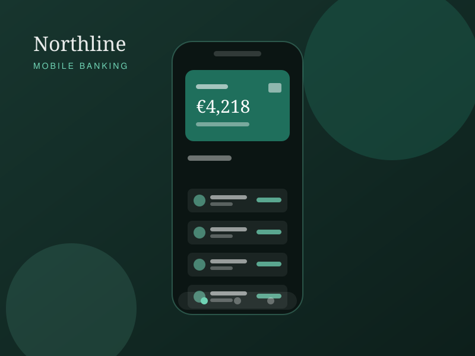

# How to edit and publish this site

A plain-language guide. No coding experience assumed — if you can use
Notepad or TextEdit, you can do everything in here.

---

## 1. What's in the folder

```
site/
├── index.html          the home page
├── work.html           the portfolio / gallery page
├── contact.html        the contact page
├── GUIDE.md            this file
├── css/
│   └── style.css       all the colours, fonts and layout
├── js/
│   └── main.js         the menu, the fade-ins and the pop-up gallery
└── images/
    ├── work-1.svg … work-6.svg   the six project pictures
    ├── portrait.svg             the "about me" picture
    ├── favicon.svg              the little icon in the browser tab
    ├── apple-touch-icon.png     the same icon for phone home screens
    └── og-card.svg              the preview image used by social media
```

That is the whole site. There is no database, no login, nothing to install.

**Before you change anything:** make a copy of the whole `site` folder and
keep it somewhere safe. If an edit goes wrong you can just put the old file
back.

---

## 2. How to open the files

- **Windows** — right-click the file → *Open with* → *Notepad*.
- **Mac** — right-click → *Open With* → *TextEdit*. The first time, go to
  TextEdit → Settings → Format → tick **Plain text**, or it will add
  invisible formatting that breaks the page.
- **Better option (free)** — install [VS Code](https://code.visualstudio.com/).
  It colours the code, which makes it much harder to delete the wrong thing.

To see your change: save the file, then double-click `index.html`. It opens
in your browser straight from your computer. Press **Ctrl+R** (Windows) or
**Cmd+R** (Mac) to refresh after each save.

---

## 3. The one rule

HTML is made of **tags** in angle brackets, in pairs:

```html
<h1>I design calm, useful interfaces</h1>
 ↑ opening tag                        ↑ closing tag (note the slash)
```

**Change the words between the tags. Leave the tags alone.** That's it.

```html
<h1>Photography that doesn't waste your afternoon</h1>   ← fine
<h1>Photography that doesn't waste your afternoon        ← broken, no closing tag
```

If you need a real `<`, `>` or `&` in your text, type `&lt;`, `&gt;` or
`&amp;` instead.

---

## 4. Changing the text

Open the page you want, find the words, type over them. The most common ones:

| What you want to change | File | Look for |
|---|---|---|
| Name in the top-left corner | all three | `<span class="logo__text">` |
| The two letters in the green square | all three | `<span class="logo__mark">` |
| Big headline on the home page | `index.html` | `<h1 class="hero__title">` |
| Paragraph under the headline | `index.html` | `<p class="hero__lead">` |
| "A little about me" text | `index.html` | `class="about__text"` |
| The three numbers (10+, 40, 6) | `index.html` | `class="facts"` |
| Project names and dates | `work.html` | `class="gallery__title"` |
| Studio address, hours, links | `contact.html` | `class="details"` |
| Copyright line at the bottom | all three | `class="site-footer__copy"` |

Each section in every file has a comment above it like
`<!-- ====== HERO ====== -->` so you can find your way around by scrolling.

---

## 5. Changing the pictures

The pictures are currently placeholder artwork I drew so you could see the
layout working. Replacing them with your own is two steps.

**Step 1 — prepare the file.**

- Save as **JPG** for photographs, **PNG** if you need a transparent
  background.
- Make it **1600 pixels wide at the most**. Anything bigger just makes the
  page slow; nobody will see the extra detail.
- Run it through [squoosh.app](https://squoosh.app) (free, no sign-up) and
  aim for under **200 KB** per picture. This is the single biggest thing you
  can do to keep the site fast.

**Step 2 — put it in place.**

Drop the file into the `images` folder, then find the line that points at the
old one and change two things: the filename and the description.

```html

```

becomes

```html

```

Three things to get right:

- **`src`** — the filename, spelled exactly, including capital letters.
  `Photo.JPG` and `photo.jpg` are different files as far as a web server is
  concerned, even though they look the same on your own computer.
- **`width` and `height`** — the real pixel size of your image. These stop
  the page from jumping about while the picture loads. Right-click the file →
  *Properties* / *Get Info* to find the numbers.
- **`alt`** — a short description of what is in the picture. This is what
  someone using a screen reader hears, what shows if the image fails to load,
  and what Google reads. Describe the picture, don't list keywords.

On the `work.html` page each picture appears **twice** on the same line
block — once in `href="images/…"` (the big version the pop-up shows) and once
in `src="images/…"` (the thumbnail). Change both.

To use the same photo for both, just put the same filename in both places.

---

## 6. Changing the colours

Everything is driven by seven colours at the top of `css/style.css`:

```css
:root {
  --paper:      #fbfaf7;   /* page background            */
  --surface:    #ffffff;   /* cards, form fields         */
  --ink:        #15181c;   /* body text                  */
  --muted:      #5c6470;   /* secondary text             */
  --accent:     #1f6f5c;   /* links, buttons, highlights */
  --accent-dk:  #164f42;   /* accent, hover state        */
  --line:       #e4e0d8;   /* hairline borders           */
}
```

Change `--accent` and the buttons, links, logo square and hover underlines all
follow. You don't need to hunt through the file.

One warning: light grey text on a white background is pretty but a lot of
people genuinely cannot read it. Paste your new colours into
[webaim.org/resources/contrastchecker](https://webaim.org/resources/contrastchecker/)
and keep the score above **4.5** for body text. The colours shipped here
score between 5.7 and 17, so there is plenty of room to make them your own.

There is a second block further down beginning `@media (prefers-color-scheme: dark)`.
That's the dark version the site shows to people whose phone or laptop is set
to dark mode. If you only ever want the light version, delete that whole block.

---

## 7. Changing the browser-tab icon (favicon)

Open `images/favicon.svg` in a text editor. It's two lines:

```html
<rect width="64" height="64" rx="14" fill="#1f6f5c"/>
<text ...>JA</text>
```

Change `JA` to your own initials and `#1f6f5c` to your colour. Save.

If you'd rather use a logo image, put a 512×512 PNG in the `images` folder and
change this line (it's near the top of all three HTML files):

```html
<link rel="icon" href="images/favicon.svg" type="image/svg+xml">
```

to

```html
<link rel="icon" href="images/my-logo.png" type="image/png">
```

Browsers cache the old icon hard. If you don't see the change, open the page
in a private window.

---

## 8. Making the contact form actually send you mail

Right now the form checks what the visitor typed and then says thank you —
but nothing is sent anywhere. A plain HTML file can't send email on its own;
it needs something to hand the message to. The simplest free option:

1. Go to [formspree.io](https://formspree.io), sign up, create a form. It
   gives you a web address like `https://formspree.io/f/abcdwxyz`.
2. In `contact.html`, find this line:

   ```html
   <form class="form reveal" id="contact-form" action="" method="post">
   ```

   and put the address in the quotes:

   ```html
   <form class="form reveal" id="contact-form" action="https://formspree.io/f/abcdwxyz" method="post">
   ```

3. In `js/main.js`, scroll to the bottom of section 4 and delete these three
   lines (they are marked with a comment telling you to):

   ```js
   e.preventDefault();
   status.textContent = 'Thanks — your message looks good. (Demo form: no address is wired up yet.)';
   form.reset();
   ```

Send yourself a test message and check your spam folder — the first one
usually lands there.

---

## 9. Putting the site online

Everything here is plain files, so any host will serve it. Three routes,
easiest first.

### Option A — Netlify Drop (two minutes, free)

1. Go to [app.netlify.com/drop](https://app.netlify.com/drop).
2. Drag the whole `site` folder onto the page.
3. It's live, on an address like `curious-otter-1a2b3c.netlify.app`.

Sign up for the free account afterwards if you want to keep the address or
point your own domain at it. To update later, drag the folder on again.

### Option B — your own hosting, via FTP

If you bought hosting (Bluehost, SiteGround, Hostinger, a cPanel account…),
they gave you FTP details: a server address, a username and a password.

1. Install [FileZilla](https://filezilla-project.org/) (free).
2. Connect with those details.
3. On the right-hand side, open the folder called `public_html`, `www` or
   `htdocs` — different hosts name it differently; it's the one that's already
   there.
4. Drag the **contents** of your `site` folder into it: `index.html`,
   `work.html`, `contact.html`, and the `css`, `js` and `images` folders.

Upload the contents, not the `site` folder itself — otherwise your site ends
up at `yourdomain.com/site/` instead of `yourdomain.com/`.

`index.html` is special: it's the page a web server shows when someone types
your domain with nothing after it. Don't rename it.

### Option C — GitHub Pages (free, good if you'll make regular edits)

Create a repository, upload the files, then Settings → Pages → Source:
*Deploy from a branch* → `main` / `root`. It publishes at
`yourname.github.io/repository-name`. Note that the repository must be
**public** for Pages to work on a free account.

---

## 10. Before you tell anyone the address

A short list worth running through:

- [ ] Every page's `<title>` says something specific — it's the blue line in
      Google results and the text in the browser tab.
- [ ] Every page's `<meta name="description">` reads like a sentence, roughly
      150 characters. Google often shows it under the title.
- [ ] Every `alt` describes its actual picture.
- [ ] Click every link, including the ones in the footer. The three social
      links on the contact page are `href="#"` placeholders — they currently
      go nowhere.
- [ ] Open the site on your phone.
- [ ] Send yourself a message through the contact form.
- [ ] Change `https://example.com/` in each page's `<link rel="canonical">`
      to your real address. It tells Google which address is the official one.

---

## 11. If something breaks

**The page looks like plain text with no styling.** The browser can't find
`css/style.css`. The `css` folder has to sit next to the HTML files, and the
folder name is lowercase.

**An image shows as a broken icon.** Nine times out of ten it's the spelling
or the capital letters in the filename. `IMG_4021.JPG` is not `img_4021.jpg`.

**The menu button does nothing on mobile.** The browser can't find
`js/main.js`, same as above.

**Something looks wrong and you can't see why.** Press **F12** to open the
browser's developer tools and click the *Console* tab. Red text there usually
names the exact file and line.

**You've made a mess.** This is what the backup copy from section 1 is for.
Put the old file back and start that edit again.

---

## 12. What was built in, in case you're asked

- Hand-written HTML5, CSS and JavaScript. No frameworks, no jQuery, no
  Bootstrap, nothing loaded from anyone else's server — so there is nothing
  to keep updated and nothing that can break when a third party changes.
- The whole site is about 100 KB including all the images.
- Works in current Chrome, Firefox, Safari and Edge. Tested in the engines
  behind all three (Chromium, Gecko, WebKit) at phone, tablet and desktop
  sizes.
- Readable and navigable with JavaScript switched off.
- Keyboard-friendly: a skip link, visible focus outlines, the pop-up gallery
  closes with Escape and moves with the arrow keys.
- Respects "reduce motion" — if a visitor has asked their device to limit
  animation, the fade-ins don't run.
- Prints sensibly, with the navigation and the pop-up stripped out.
